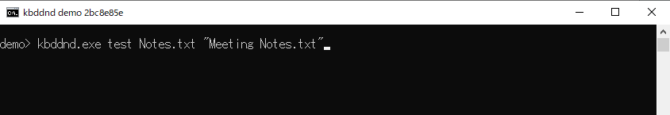
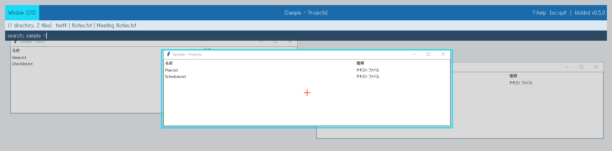

# kbddnd

Windowsで、コマンドラインから指定したファイルを、キーボードで選んだウィンドウにドラッグ＆ドロップするツールです。C/Migemoなしでも、ウィンドウの検索、部品・位置の選択、ファイルの送信ができます。

## 使用例

コマンドプロンプトで送信するファイルを指定します。この例では `kbddnd.exe test Notes.txt "Meeting Notes.txt"` を実行し、ディレクトリ `test` と2つのファイルをまとめて送ります。



起動したら `sample -` と入力して候補を3件に絞り、← / → で送信先を選びます。下の画面では中央の `Sample - Projects` が選択中（2/3）です。周囲が少し暗くなり、背面にある対象も元の位置と大きさでプレビューされます。水色の枠が対象ウィンドウ、オレンジ色の十字が送信位置を示します。Enterで送信します。



## ビルドと起動

Visual Studio 2022のC++ビルドツールとWindows SDKを用意し、**x64 Native Tools Command Prompt** でリポジトリのルートから実行します。

```bat
cl /nologo /std:c++17 /EHsc /utf-8 /W4 kbddnd.cpp /link /SUBSYSTEM:CONSOLE
kbddnd.exe "C:\work\画像 1.png" "C:\work\資料.txt"
```

引数なしで `kbddnd.exe` を実行すると、標準出力にバージョンと使い方を表示して終了します。ファイルとディレクトリを1件から指定できます。相対パスは起動時の作業ディレクトリを基準に解決します。ビルドと通常の文字列検索にはC/Migemoは不要です。

## ウィンドウの検索

標準では、ウィンドウタイトルまたは実行ファイル名（拡張子を除く）に、入力した文字列が含まれる候補を表示します。大文字・小文字は区別しないので、たとえば `projects` で上の例の `Sample - Projects` が見つかります。日本語のタイトルも `設定` のように直接入力して検索できます。

### C/Migemoでローマ字検索を追加する（任意）

`settei` のように読みをローマ字で入力して「設定」を探したい場合は、C/Migemoを導入してください。

64ビット版では、C/Migemoの `migemo.dll` を `kbddnd.exe` の隣に置き、CP932版の辞書と変換表を `dict\` に置きます。以下のPowerShellコマンドを実行ファイルのあるフォルダーで実行してください。使用するのはC/MigemoプロジェクトのWindows x64向け20110227版です。[C/Migemo公式サイト](https://www.kaoriya.net/software/cmigemo/)

```powershell
$work = New-Item -ItemType Directory -Path (Join-Path $env:TEMP ([guid]::NewGuid().ToString()))
$zip = Join-Path $work.FullName 'cmigemo.zip'
$url = 'https://storage.googleapis.com/google-code-archive-downloads/v2/code.google.com/cmigemo/cmigemo-default-win64-20110227.zip'
Invoke-WebRequest -Uri $url -OutFile $zip -ErrorAction Stop
if ((Get-FileHash $zip -Algorithm SHA256).Hash -ne '80ADCF55848B46F8EB006FF4F73C5B840E7E322529D5D4E534BE235FF0BB4AD0') {
    throw 'C/MigemoのZIPのハッシュが一致しません。'
}
Expand-Archive -LiteralPath $zip -DestinationPath $work.FullName -ErrorAction Stop
$src = Join-Path $work.FullName 'cmigemo-default-win64'
Copy-Item -LiteralPath (Join-Path $src 'migemo.dll') -Destination . -ErrorAction Stop
New-Item -ItemType Directory -Force -Path .\dict | Out-Null
Copy-Item -Path (Join-Path $src 'dict\cp932\*') -Destination .\dict -ErrorAction Stop
```

配置後にkbddndを起動し、タイトルに「設定」を含むウィンドウが `settei` で見つかれば導入完了です。32ビットビルドにはWin32版のDLLを `migemo32.dll` という名前で配置します。

## 操作

| 場面 | キー | 動作 |
| --- | --- | --- |
| ウィンドウ選択 | 文字入力（Spaceを含む） | タイトルと実行ファイル名で絞り込みます。C/Migemoを導入すると、ローマ字の読みでも検索できます。 |
| ウィンドウ選択 | ← / → | 左右キーで表示順に候補を切り替えます。既存の候補は順序を保ち、新しい候補は末尾に追加されます。Enterで選択中のウィンドウの中央に送信します。 |
| ウィンドウ選択 | Backspace / Ctrl+U・Ctrl+K | 検索文字の末尾を1文字削除 / 全消去します。 |
| ウィンドウ選択 | Tab | 部品選択に入ります。候補がなければ位置選択に進みます。 |
| 部品選択 | 方向キー / Tab | 指定方向の候補へ移動 / 選択中の部品から位置選択に切り替えます。 |
| 位置選択 | 方向キー | 表示倍率100%で16px移動します。Ctrl併用で64px、Shift併用で倍率にかかわらず1px移動します。 |
| 部品選択・位置選択 | Enter | 十字で示した位置に送信します。 |
| 部品選択・位置選択 | Shift+Tab | 一段戻ります。部品がなくWindowからPositionに直接進んだ場合は、Windowに戻ります。 |
| 各モード | Esc | Windowでは検索語の有無にかかわらず終了します。Part・Positionでは一段戻ります。 |
| 各モード | ? | 現在のモードの英語ヘルプを表示します。次のキーはヘルプを閉じるために使います。 |

青い帯の左端はモード（`Window`・`Part`・`Position`）を示します。候補のあるモードでは選択番号と件数も表示します。中央には対象名、部品選択ではクラス名と中心座標、位置選択では送信座標が表示されます。右端にはヘルプ・Escの動作・バージョンが表示されます。

その下の行にはディレクトリ数とファイル数、指定順の名前を表示します。ディレクトリ名には末尾に `\` が付き、一覧が横幅に収まらない場合は `...` で省略します。Windowで文字を入力すると、濃紺の行に `search:` と検索語、カーソルが現れます。検索語が空になると行は消えます。ヘルプは白、メッセージは薄い黄色で、同じ場所にどちらか一方を表示します。

ライブプレビューには Windows のデスクトップ ウィンドウ マネージャー（DWM）を使用します。プレビューに `explorer.exe` の起動は不要です。候補の切り替えや部品・位置の選択中も、実際のウィンドウの重なり順は保たれます。Enterで送信を確定したとき、送信位置が別のウィンドウに隠れていれば対象を手前に出して位置を再確認します。

独自描画のアプリでは、ドロップ可能な領域が部品候補に現れない場合があります。その場合は位置選択で十字を受付領域に合わせてください。送信には `WM_DROPFILES` またはOLEのコピー操作を使います。OLEで拒否された場合は、オーバーレイで位置を選び直せます。

## 改版履歴

| バージョン | 主な変更 |
| --- | --- |
| 0.5.0 | オーバーレイを英語表示にし、送信するディレクトリ数とファイル数を個別に表示。モード別ヘルプ（`?`）と検索行を追加。Ctrl+U / Ctrl+K で検索を全消去、Window では Esc で終了、Part・Position では Shift+Tab または Esc で一段戻る。 |
| 0.4.0 | DWMによるライブプレビューを追加。周囲を暗くし、背面の送信先も重なり順を保ったまま元の位置と大きさで表示。青い帯の下に送信件数とファイル名を並べ、横幅に収まらないときは末尾を `...` で省略。 |
| 0.3.3 | ウィンドウの重なり順が変わっても候補の表示順を保ち、右キーで対象を切り替えても同じ番号が続く問題を修正。 |
| 0.3.2 | 部品選択時に部品自身のクラス名、取得できた部品名、中心座標を表示。タスクバーなどで部品を識別しやすくした。 |
| 0.3.1 | モード切り替えをTabに統一し、Spaceを検索に使用可能にした。オーバーレイを左からモード・検索、対象、キー操作の順に整理。メッセージは薄い黄色の専用行に表示し、次のキー操作で消去。送信位置が隠れているときは対象を前面に出して再確認。 |
| 0.3.0 | ウィンドウタイトル・実行ファイル名による絞り込みと、任意で導入できるC/Migemoによるローマ字検索を追加。Backspaceで1文字削除、Ctrl+Uで検索を全消去。 |
| 0.2.0 | Spaceでの部品選択と、十字による座標指定を追加。OLEの受付待ちと、タスクバーなどで拒否された後のキーボードフォーカス復帰を改善。 |
| 0.1.0 | 初版。コマンドラインで指定した複数ファイルを、オーバーレイで選んだウィンドウの中央にドロップ。 |
